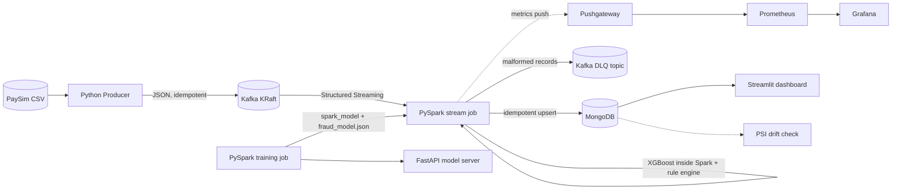

# FraudPulse v2 — Real-Time Fraud Detection with PySpark + XGBoost


-blue?style=flat-square)


A streaming pipeline that ingests financial transactions from Kafka, scores them for fraud with an
**XGBoost model trained and executed inside Spark**, stores the results in MongoDB and shows them on a
live dashboard. **100% Python** — no Scala, no sbt, no JVM build step.

> v1 used Scala + XGBoost4J-Spark. v2 replaces it with PySpark + `xgboost.spark.SparkXGBClassifier`.

## Architecture



Full explanation of every component and data flow: **[docs/ARCHITECTURE.md](docs/ARCHITECTURE.md)**.

## Quickstart

Requirements: Docker Desktop with ≥ 10 GB RAM allocated (2 Spark workers × 3 GB + Kafka/Mongo/etc.). On a smaller machine set `TRAIN_SAMPLE_FRACTION=0.3` in `.env` and lower `--memory` for the workers in `docker-compose.yml`, `make` (or run the commands in the Makefile by hand).

```bash
cp .env.example .env                    # 1. config
# 2. data: put PaySim at data/paysim.csv  (see data/README.md)  -- or for a smoke test:
python scripts/make_sample_data.py --rows 50000 --out data/paysim.csv

make up                                 # 3. Kafka, Mongo, Spark cluster, producer, dashboard, API
make train                              # 4. distributed XGBoost training inside Spark -> models/
make logs                               # 5. watch micro-batches being scored
```

The streaming job waits for the model, so the order `up` → `train` just works (no restart needed).

| Service | URL |
|---|---|
| Dashboard | http://localhost:8501 |
| Spark master UI | http://localhost:8080 |
| Model server (REST) | http://localhost:8000/docs |
| Grafana / Prometheus (optional `make up-full`) | http://localhost:3000 / http://localhost:9090 |
| MLflow (optional `make up-full`) | http://localhost:5000 |

Try the REST scorer once the model exists:

```bash
curl -X POST localhost:8000/predict -H 'content-type: application/json' -d \
 '{"step":10,"type":"TRANSFER","amount":250000,"oldbalanceOrg":250000,"newbalanceOrig":0,"oldbalanceDest":0,"newbalanceDest":0}'
```

## Project layout

```
src/
├── fraudpulse/        shared library: config, features, scoring, sinks, metrics
├── jobs/
│   ├── train.py       PySpark: distributed XGBoost training + evaluation + artefacts
│   └── stream.py      PySpark Structured Streaming: Kafka -> XGBoost -> MongoDB
├── producer/          Python Kafka producer (confluent-kafka)
├── model_server/      FastAPI REST scorer (same model, same features)
├── monitoring/        PSI data-drift check
├── dashboard/         Streamlit app
└── mongo/             collection + index initialisation
docker/spark/          one image for Spark master, workers, trainer and stream job
config/                Prometheus + Grafana provisioning (dashboard included)
tests/                 pytest suite (runs a real local Spark)
```

## Status — what was verified and what was not

Verified by automated tests / local runs (local Spark 3.5.3, XGBoost 2.0.3, Java 17):

- Spark feature expressions give identical values to the plain-Python `row_features` (no train/serve skew)
- Distributed XGBoost training via `SparkXGBClassifier` (2 workers), model save → load, scoring of a micro-batch
- The exported plain XGBoost booster (used by the REST server) matches the Spark model's probabilities
- `foreachBatch` streaming query: valid records scored, malformed records separated for the DLQ
- Idempotent MongoDB upsert (tested with `mongomock`), PSI drift maths

**Not yet run end-to-end by the author of this code:** the full Docker Compose stack against real Kafka, MongoDB,
Grafana and MLflow. Run `make up && make train` first and fix anything environment-specific before relying on it.
No load-test or latency numbers are published: measure them yourself (Spark UI → Structured Streaming tab,
Grafana "Micro-batch duration") and add real figures here.

Metrics produced by `make train` on the **synthetic** sample data are meaningless (the sample is trivially
separable). Quote metrics only from a run on the real PaySim dataset.

## Tests

```bash
pip install -r requirements-dev.txt     # Python 3.11 + Java 17 required
PYTHONPATH=src pytest -q
```

## Roadmap

- [ ] Load-test the stream job and publish measured throughput/latency
- [ ] Time-based train/test split (the current split is random)
- [ ] Alerting rules in Prometheus/Alertmanager
- [ ] Optional: scale Kafka to 3 brokers

## License

MIT
